# Habla Fluido

Aplicación de práctica de idiomas desarrollada en Flutter con un plan diario por habilidades (Oído, Pronunciación, Lectura, Escritura y Conversación), sistema de repaso espaciado (SM-2) y servidor proxy en Node.js[cite: 1, 2].

## Evidencia de pruebas y ejecución

Capturas de la carpeta `CapturasEvidencias/` documentando el ciclo de pruebas (ROJO = fallo, VERDE = aprobado), el total de pruebas y la aplicación en ejecución.

### Total de pruebas

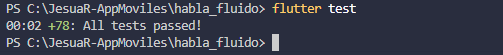[cite: 3]

### Aplicación en ejecución

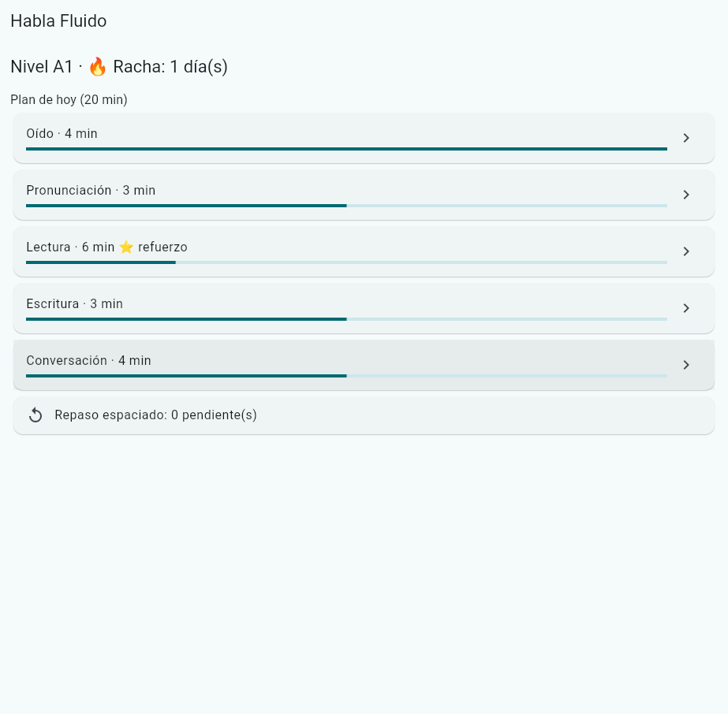[cite: 1, 3]

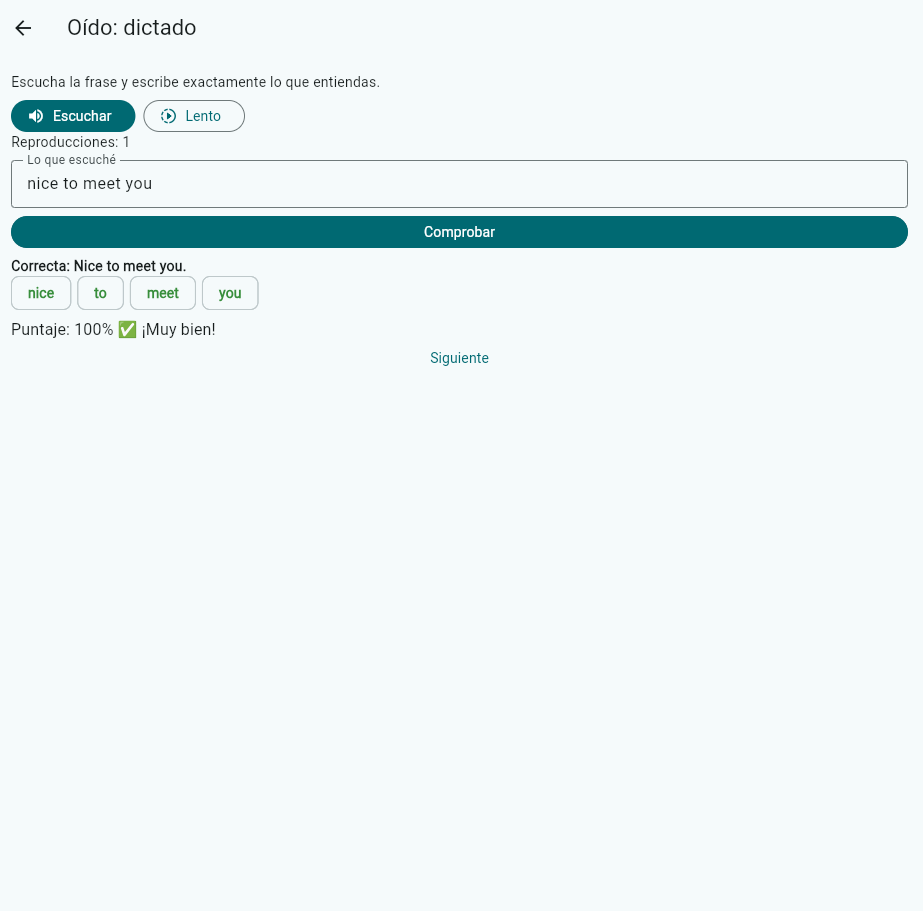[cite: 1, 3]

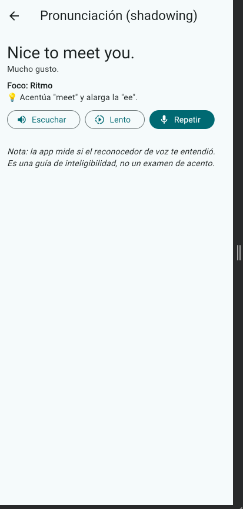[cite: 1, 3]

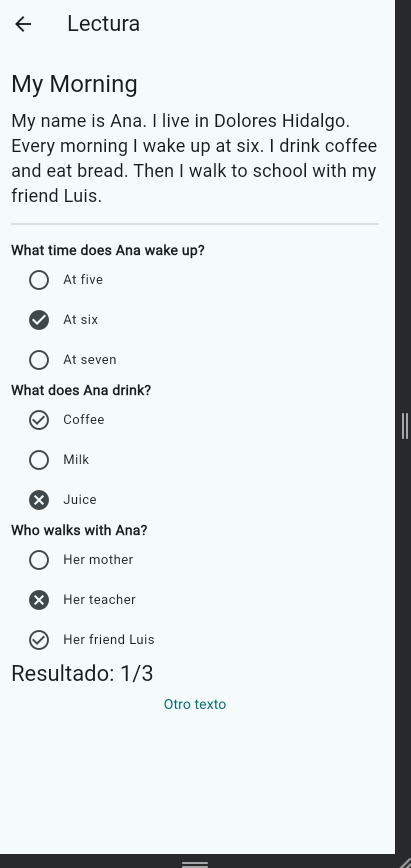[cite: 1, 3]

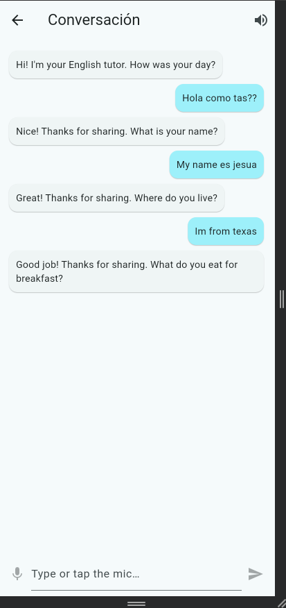[cite: 1, 3]

### Rondas de pruebas (ROJO / VERDE)

#### Ronda 2: Comparador
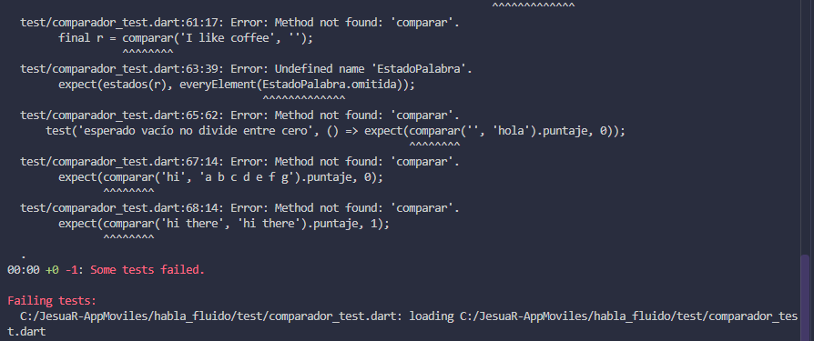[cite: 3]
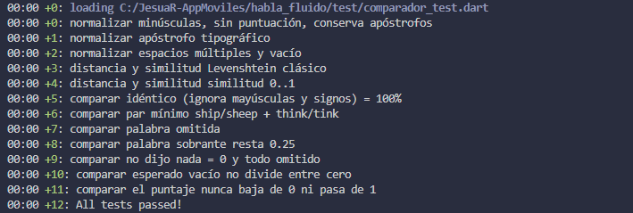[cite: 3]

#### Ronda 3: SM-2
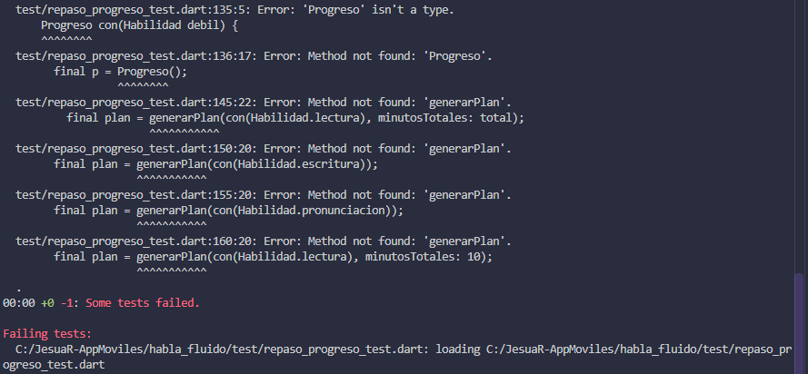[cite: 3]
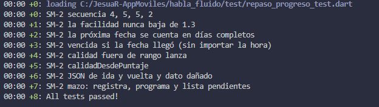[cite: 3]

#### Ronda 4: Progreso y plan
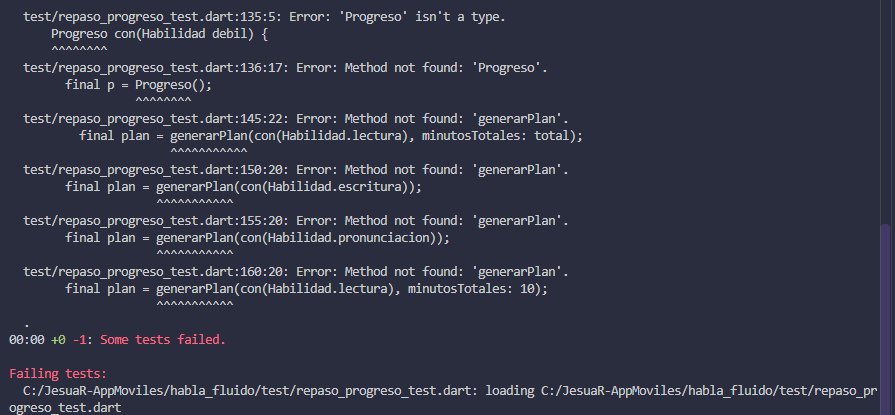[cite: 3]
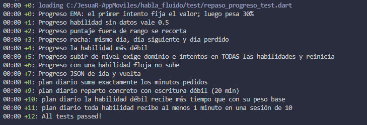[cite: 3]

#### Ronda 6: Proxy
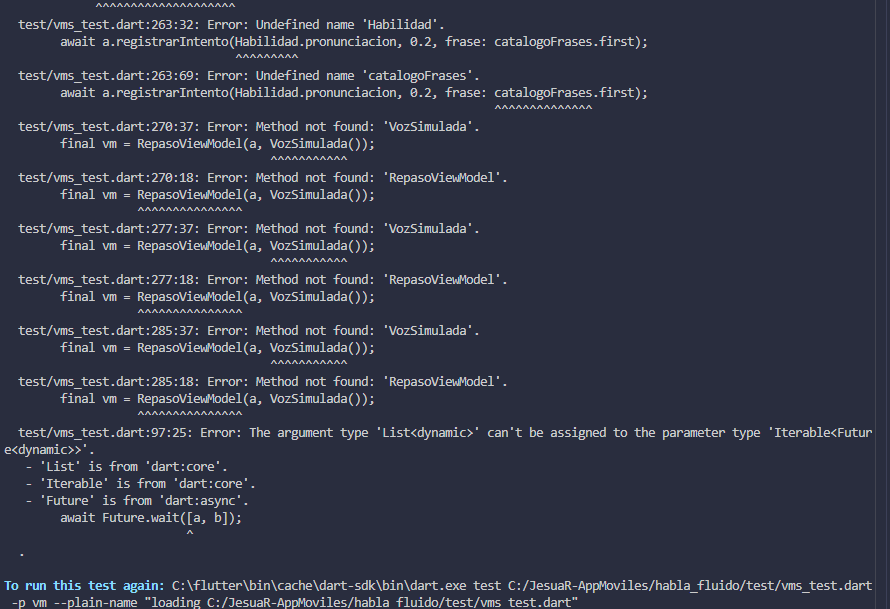[cite: 3]